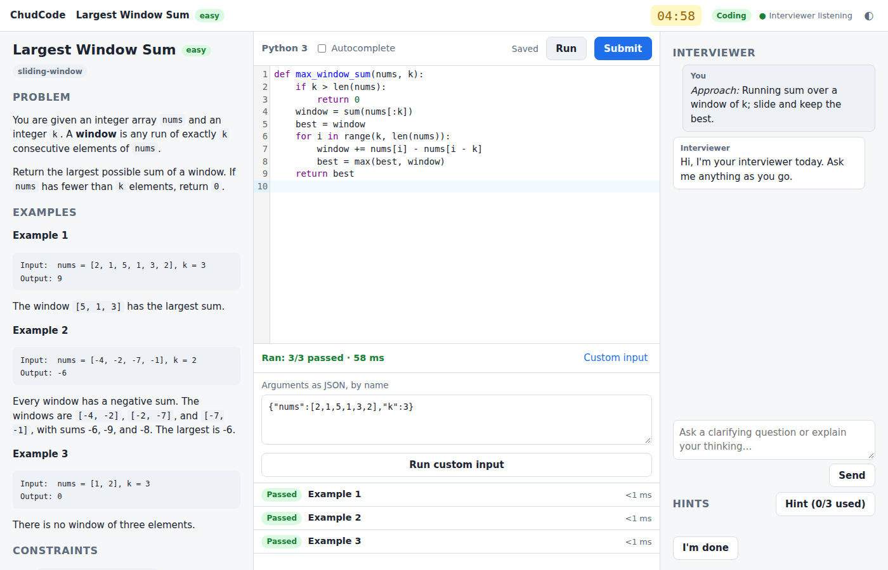
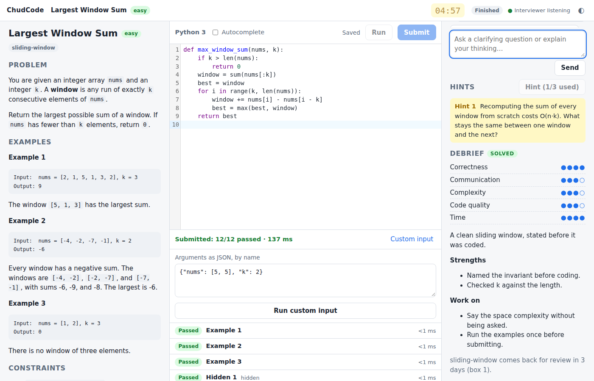
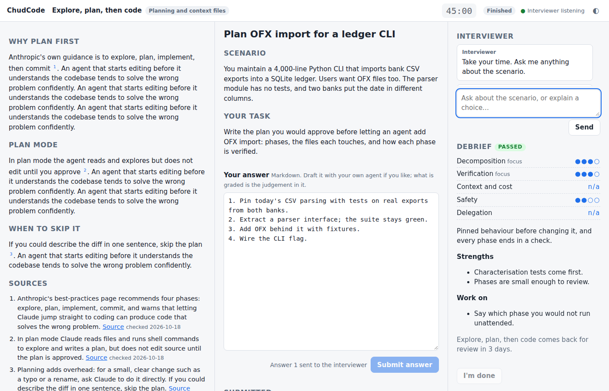

# ChudCode

A mock technical interviewer you can code against, inside Claude Code or Pi.

ChudCode generates original interview-style coding problems, serves them in a local
web page with a code editor, hidden tests, and a timer, and plays the interviewer. It
asks you to talk through your approach before you code, gives hints when you ask for
them, probes edge cases and complexity after you submit, and scores the session on a
rubric. Patterns you miss come back on a spaced-review schedule with a fresh problem,
not the one you already saw.

A second track teaches coding _with_ agents: planning with plan mode, context files,
tests an agent cannot game, subagents with the right model and effort, prompt-caching
cost, and more. Each lesson teaches a few facts sourced from Anthropic's docs, then
hands you a realistic scenario to work with your own agent, and grades your judgement.

**Status:** early development. Mock interviews work; the interviewer writes its own
problems, validated against a reference solution before they are served; the
patterns you miss come back on a Leitner schedule with a problem you have not seen;
and research into what a company has been asking shapes the problems you get for it.



## Install

ChudCode needs Node 22.18 or later and Python 3.12 or later on your PATH. It runs
TypeScript directly, with no build step.

### Claude Code

```sh
claude plugin marketplace add maddoxrjohnson/ChudCode
claude plugin install chudcode@chudcode
```

Then, in Claude Code, say "give me a mock interview on sliding windows" or run
`/chudcode:interview`. Your agent plays the interviewer; the page opens in your browser,
and the plugin prints the session's link in your terminal every time one starts.
`/chudcode:review` serves a fresh problem on the pattern you are most overdue to see
again. `/chudcode:roadmap` takes you through NeetCode 150 in order, or Grind 75 if you
name it: each step is an original problem in the shape of the next one on the list,
and after each debrief a Next problem button takes you straight to the one after.
`/chudcode:learn` teaches the next lesson on coding with agents, or the topic you
name. `/chudcode:research <company>` finds what that company has been asking lately,
so an interview for it has the right shape. `/chudcode:dashboard` opens the page with
your review schedule, streak, and past sessions.

To try a checkout without installing it: `claude --plugin-dir /path/to/ChudCode`.

### Pi

Pi gets the same tools from the same MCP server, through Pi's MCP adapter, plus an
extension for the slash commands and the bridge that pushes the candidate's actions
into the conversation. Clone the repository somewhere stable and install both:

```sh
git clone https://github.com/maddoxrjohnson/ChudCode ~/ChudCode
(cd ~/ChudCode && npm ci --omit=dev)
pi install ~/ChudCode
```

Then add the server to `~/.pi/agent/mcp.json`, with the absolute path to your clone:

```json
{
  "mcpServers": {
    "chudcode": {
      "command": "node",
      "args": ["/home/you/ChudCode/mcp/launch.mjs"],
      "env": { "CHUDCODE_HOST": "pi" },
      "exposure": "direct"
    }
  }
}
```

`CHUDCODE_HOST=pi` is what switches the server from waiting to pushing. The commands
are `/interview`, `/review`, `/roadmap`, `/learn`, `/research <company>`, and `/dashboard`. While the
interviewer is connected, Pi shows `chudcode interviewer connected on port <port>`
below the editor, and the link of the session it opened last.

## Why

Live coding interviews test a narrow skill: solving a medium-difficulty problem in
about thirty-five minutes while explaining yourself to another person. Grinding a
problem list trains the first half. ChudCode is built to train the whole thing, and to
make sure the patterns you keep missing are the ones you see again.

## What works

- In-browser editor with Run (visible examples) and Submit (hidden tests), autocomplete
  off by default to match real interview pads.
- Interview flow: clarifying questions, approach note, timer, hint ladder, follow-up
  questions, and a five-dimension rubric.
- Problems written per pattern and difficulty, or modelled on the shape of a real
  problem you name, and validated against a reference solution before you ever see
  them. The Grind 75 and NeetCode 150 lists are vendored as titles and patterns only;
  no problem statements are stored. See `docs/PROBLEM-FORMAT.md`.
- Spaced review: every scored session moves the problem's patterns between Leitner
  boxes (1, 3, 7, 21, 60 days). A review session serves a problem you have not seen
  on the most overdue pattern. The dashboard shows every pattern's box, what is due,
  and your streak. Boxes and due dates are derived on every read from an append-only
  log of verdicts, so changing the schedule or the verdict rule re-scores history.
- Roadmaps: work through NeetCode 150 topic by topic along NeetCode's tree, or Grind
  75 week by week. A topic or week opens once half of every one before it is solved.
  You never see the listed problem: each step is an original problem in its shape,
  and solving it checks the listed one off. Progress is derived from your sessions,
  so a "like Two Sum" interview counts too. After a roadmap debrief the interviewer
  writes the next step ahead of time and stays for a while; the Next problem button
  on the debrief or the dashboard opens it without a trip back to the terminal.
- Agentic coding lessons: nine modules, from planning and context files through test
  strength, subagents with chosen models and effort, and prompt-caching cost, to
  working across providers. Every claim a lesson teaches about Claude Code cites a
  fact in `data/agentic/curriculum.json`, each with the page that states it; the
  interviewer re-reads sources older than two weeks before teaching, and an exercise
  that cites anything else fails validation. You get a scenario, work it with your
  own agent, submit your plan or spec, answer follow-ups, and are scored on
  decomposition, verification, context and cost, safety, and delegation. Missed
  lessons come back on the review schedule. See `docs/LEARNING.md` and
  `docs/CURRICULUM-FORMAT.md`. Labs on your own repository and drills graded by code
  are next.
- Company trends: the research skill reads recent interview-experience posts with
  the host's web tools and records each problem as a pattern, a role, a date, a
  source, and a short paraphrase of its shape, never a statement. Name the company
  when you ask for an interview and the problem is written in the shape that company
  has been asking, citing the entries it came from. See `docs/TRENDS-FORMAT.md`.

## What it looks like

After a passing submission and the follow-ups, the interviewer scores the session.
The debrief lands on the page: five rubric scores, strengths, things to work on,
when the pattern comes back, and, on a roadmap, the button for the next problem.



A lesson shows its teaching with numbered sources on the left, the scenario and your
answer in the middle, and the interviewer on the right.



The dashboard shows every pattern's place in the review schedule, what is due, the
streak, progress through both roadmaps and the agentic-coding modules, and past
sessions.


The screenshots come from `npm run e2e:browser -- <dir>`, which drives the real page.
How the pieces fit is in `docs/ARCHITECTURE.md`.

## Development

Requires Node 22.18 or later and Python 3.12 or later.

```sh
npm install
npm run serve            # open the example problem in your browser, no agent needed
npm run validate -- window-sum   # lint a problem bundle and run its reference against every case
npm test
npm run check            # typecheck
npm run lint
npm run format
npm run bundle:editor    # rebuild assets/vendor after editing assets/editor/entry.mjs
npm run e2e:browser      # drive the interview page in headless Chromium (npx playwright install chromium first)
npm run e2e:claude       # a real `claude -p` session interviews a scripted candidate (signed-in claude; costs tokens)
```

The runner executes solutions in a separate process with memory, CPU, and wall-clock
limits. It is not a security sandbox: code runs as you, with your filesystem and
network. Treat it the way you would treat running a script you wrote yourself. To run
it in a container with no network and a read-only filesystem instead, set
`CHUDCODE_RUNNER=docker`; see `docs/RUNNER.md`.

## License

MIT © Maddox Johnson. See `docs/ATTRIBUTION.md` for the projects ChudCode learned from.
